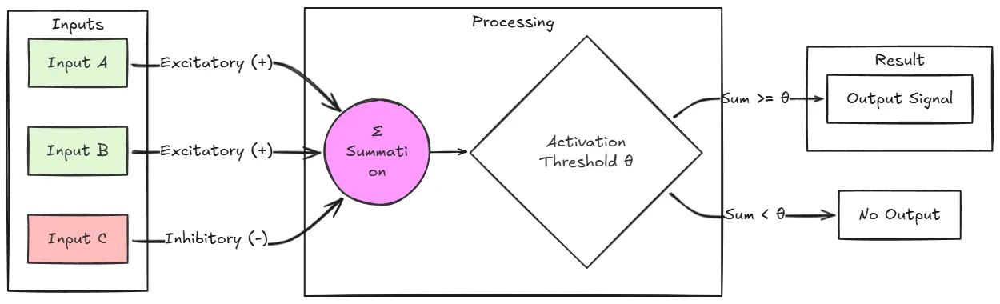
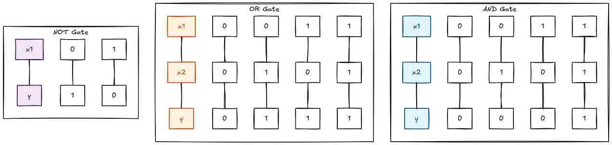
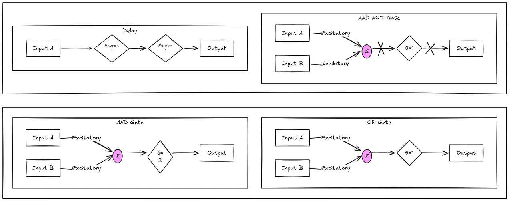
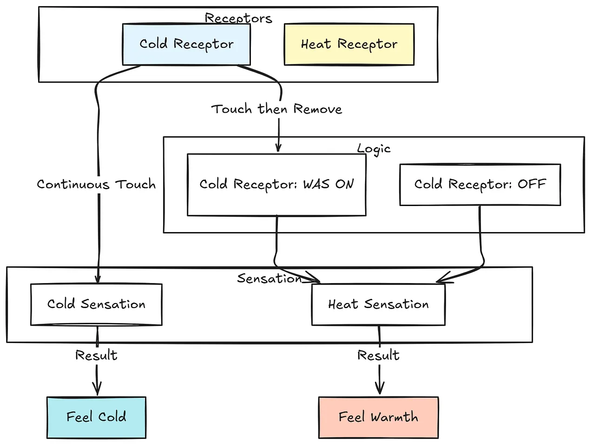

<<<<<<< HEAD
# Reproducing the McCulloch–Pitts Neuron (1943)

A small Python reconstruction of selected ideas from Warren S. McCulloch and Walter Pitts' 1943 paper, *A Logical Calculus of the Ideas Immanent in Nervous Activity*. This repository accompanies the article [Investigating the McCulloch–Pitts Neuron: Revisiting the 1943 Paper That Laid the Foundation for Neural Networks](https://natureofminds.substack.com/p/investigating-the-mccullochpitts).

The project is intended as an educational and computational companion to the article: it translates selected neuron rules, elementary logical circuits, delayed activity, and a heat/cold example into a compact Python implementation.

> **Scope note:** This is a modern, simplified implementation of selected mechanisms discussed in the paper and article. It is not a complete formal reproduction of all the paper's theorems, assumptions, or biological claims.

## Contents

- [The model](#the-model)
- [From neuron to logic](#from-neuron-to-logic)
- [Delay and network behaviour](#delay-and-network-behaviour)
- [Heat/cold example](#heatcold-example)
- [Implementation](#implementation)
- [Installation](#installation)
- [Run the examples](#run-the-examples)
- [Run the tests](#run-the-tests)
- [Limitations](#limitations)
- [References](#references)

## The model

The McCulloch–Pitts neuron is represented here as a binary threshold unit. It receives binary inputs, sums the active excitatory inputs, and fires when the threshold is reached. An active inhibitory input blocks firing.

In the simplified implementation, the firing rule is:

\[
y =
\begin{cases}
0, & \text{if any inhibitory input is active},\\
1, & \text{if } \sum_i x_i \geq \theta,\\
0, & \text{otherwise}.
\end{cases}
\]

Here, \(x_i\) are binary excitatory inputs and \(\theta\) is the firing threshold.



*Figure 1. Conceptual diagram of the threshold-neuron model used in this repository. Excitatory inputs contribute to summation; an inhibitory input can prevent the output signal.*

## From neuron to logic

By changing the threshold and the arrangement of excitatory and inhibitory inputs, a neuron can implement simple Boolean functions.



*Figure 2. Truth-table-style illustrations of NOT, OR, and AND gate behaviour.*

The implementation also provides constructors for OR, AND, and AND-NOT neurons. The AND-NOT construction fires when input A is active and input B is not active.

The following diagram shows circuit-style representations of delay, AND-NOT, AND, and OR arrangements.



*Figure 3. Circuit illustrations showing elementary logical arrangements and a chain of neurons used to introduce a delay.*

## Delay and network behaviour

The `Net` class updates neurons in discrete time steps. At each step, a neuron evaluates the activity from the preceding step. A chain of pass-through neurons therefore propagates a signal with a delay.

This discrete-time mechanism is used in the heat/cold example below. It is a simplified computational illustration; it should not be read as a complete simulation of sensory physiology.

## Heat/cold example

The repository includes a small network inspired by the heat/cold example discussed in the article. It models a cold-receptor signal, a delayed copy of that signal, a rebound condition, and outputs representing heat and cold sensations.



*Figure 4. Conceptual flow diagram of the heat/cold receptor example described in the accompanying article.*

Run the example to see the network's outputs for brief and sustained cold-input scenarios.

## Implementation

The package is organised as follows:

```text
src/mcp_neuron/
├── neuron.py                 # Binary threshold neuron
├── network.py                # Discrete-time network simulation
├── gates.py                  # OR, AND, and AND-NOT constructors
└── examples/
    ├── order0_logic.py       # Example of a logical condition
    └── heat_cold.py          # Heat/cold temporal example

tests/
├── test_neuron.py
├── test_gates.py
├── test_order0_logic.py
└── test_heat_cold.py

docs/
├── model-and-article-map.md
└── figures/                  # Diagrams supplied with the accompanying article
```

## Installation

Python 3.9 or later is required.

Clone the repository and install the package with its development dependency:

```bash
git clone https://github.com/yargul-khan/reproducing-mcculloch-pitts.git
cd reproducing-mcculloch-pitts
python -m pip install -e ".[dev]"
```

## Run the examples

Run the heat/cold example:

```bash
python -m mcp_neuron.examples.heat_cold
```

Run the logical-condition example:

```bash
python -m mcp_neuron.examples.order0_logic
```

## Run the tests

```bash
pytest
```

## Limitations

- The model uses binary, discrete-time signals and a simplified threshold rule.
- The implementation focuses on selected examples; it does not encode every theorem or construction from the 1943 paper.
- The heat/cold example is a schematic logical demonstration, not a validated physiological model.
- The diagrams are explanatory illustrations accompanying the article; they are not generated by the Python package.
- The implementation does not include learning or parameter training.

## References

1. McCulloch, W. S., & Pitts, W. (1943). A logical calculus of the ideas immanent in nervous activity. *The Bulletin of Mathematical Biophysics*, 5, 115–133.
2. Gul, Y. (2026). [Investigating the McCulloch–Pitts Neuron: Revisiting the 1943 Paper That Laid the Foundation for Neural Networks](https://natureofminds.substack.com/p/investigating-the-mccullochpitts).

---

Developed as an independent educational and research-oriented implementation by [Yar Gul](https://github.com/yargul-khan).
=======
# reproducing-mcculloch-pitts
A modern yet simple Python implementation of McCulloch–Pitts ' 1943 foundational paper on artificial neurons. It is an accompanying code repository for the Substack article titled Investigating the McCulloch–Pitts Neuron: Revisiting the 1943 Paper That Laid the Foundation for Neural Networks
>>>>>>> 153a4ab4b8fd608ed1226de33d138db5d372ea4c
